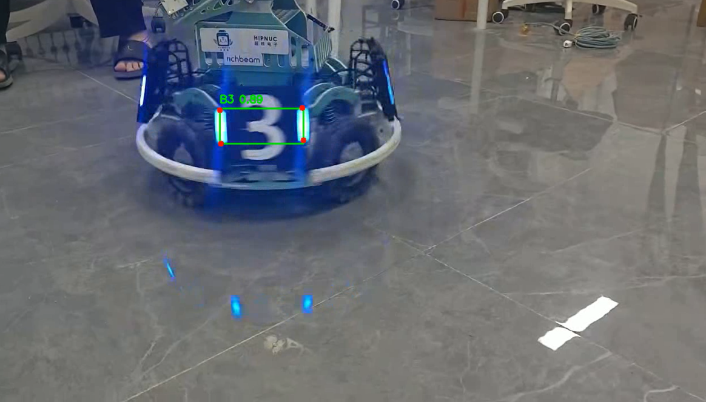

# 装甲板检测与关键点推理（YOLO-Pose）

本仓库为第一次作业的代码与文档，内容是：**对一段自行拍摄的装甲板视频做逐帧推理，输出带检测框、类别、置信度和 4 个关键点的结果视频**，并打印本次推理的统计信息。

---

## 1. 项目完成的功能

- 读取指定视频，逐帧调用 YOLO-Pose 模型推理；
- 在画面上绘制三类信息：
  1. **检测框**（绿色矩形）；
  2. **类别 + 置信度**（带深色背景的标签，例如 `B3 0.86`）；
  3. **4 个关键点**（红色圆点）并连成**四边形**（黄色连线），即装甲板四角；
- 写出带标注的结果视频；
- 打印统计信息：处理帧数、有检测的帧占比、检测总数、各类别数量、平均置信度、耗时、平均速度。

模型为 **pose（关键点）任务**，输出 `kpt_shape = [4, 2]`，即每个目标固定输出 4 个关键点的 (x, y)；类别共 6 个：`B1, B2, B3, R1, R2, R3`（红/蓝方 1~3 号装甲板）。

仓库结构：

```
yolo-armor-inference/
├── inference.py          # 推理脚本（主程序）
├── requirements.txt      # 依赖说明
├── README.md             # 本文档
├── .gitignore            # 排除权重/视频/虚拟环境
├── docs/
│   └── result.png        # 代表性结果截图
├── best.pt               # 模型权重（未提交，见第 3 节）
└── input.mp4             # 原始视频（未提交，见第 5 节）
```

---

## 2. 运行环境：Python 版本、主要依赖、CPU 还是 GPU

| 项目 | 值 |
|---|---|
| 操作系统 | Windows 11（25H2，Build 26200） |
| Python | **3.11.9** |
| ultralytics | 8.4.178 |
| torch | 2.14.1**+cpu** |
| torchvision | 0.29.1 |
| opencv-python | 4.11.0.86 |
| numpy | 1.26.4 |
| 推理设备 | **CPU** |

**说明：本作业使用 CPU 推理。** 本机显卡为 Intel Iris Xe 核显，没有 NVIDIA 独立显卡，`torch.cuda.is_available()` 返回 `False`，因此无法使用 CUDA 加速。

实测速度：在 1280×720 分辨率下约 **20.4 fps**，13.4 秒（402 帧）的视频推理耗时约 **19.7 秒**，可以满足本作业的验证需求。

---

## 3. 模型权重的准备方式与放置位置

- 权重由**课程提供的 `best.pt`**（约 5.6 MB），无需自行训练；
- 放置位置：**放在项目根目录**，与 `inference.py` 同级，脚本默认从 `./best.pt` 读取：

```
yolo-armor-inference/
├── inference.py
└── best.pt        ← 放这里
```

- 也可以放在任意位置，通过 `--model` 指定路径；
- 按作业要求，**模型权重不提交到 Git 历史**，已由 `.gitignore` 的 `*.pt` 规则排除。

---

## 4. 依赖安装步骤、运行命令和结果保存位置

### 4.1 安装依赖

```bash
# 1) 创建并激活虚拟环境（可选但推荐）
python -m venv .venv
.venv\Scripts\activate          # Windows
# source .venv/bin/activate     # Linux / macOS

# 2) 安装依赖
pip install -r requirements.txt
```

如果只需要 CPU 版 torch（体积更小，本作业用不到 GPU），可以先单独安装：

```bash
pip install torch==2.14.1 torchvision==0.29.1 --index-url https://download.pytorch.org/whl/cpu
pip install -r requirements.txt
```

### 4.2 运行推理

```bash
# 使用默认参数（读取 ./best.pt 与 ./input.mp4，输出 ./output.mp4）
python inference.py

# 等价于显式指定全部参数
python inference.py --model best.pt --source input.mp4 --output output.mp4

# 提高置信度阈值，或指定设备
python inference.py --conf 0.5 --device cpu
```

参数说明：

| 参数 | 默认值 | 说明 |
|---|---|---|
| `--model` | `best.pt` | 模型权重路径 |
| `--source` | `input.mp4` | 输入视频路径 |
| `--output` | `output.mp4` | 结果视频保存路径 |
| `--conf` | `0.25` | 置信度阈值 |
| `--device` | 空（自动） | 推理设备，如 `cpu`、`0` |

### 4.3 结果保存位置

- **结果视频**：默认保存为项目根目录下的 **`output.mp4`**（可用 `--output` 改到其他路径，例如 `--output results/my_output.mp4`，脚本会自动创建目录）；
- **统计信息**：直接打印在终端，格式如下（真实运行输出）：

```
[1/3] Loading model: best.pt
      task=pose  classes=6  kpt_shape=[4, 2]
[2/3] Input: 1280x720 @ 30.0 fps, 402 frames (13.4 s)
[3/3] Running inference (device=auto, conf=0.25) ...
==============================================================
 Inference summary
==============================================================
 frames processed : 402 / 402
 frames with det  : 402 (100.0%)
 total detections : 625
 mean confidence  : 0.747
 detections/class : {'B3': 625}
 elapsed          : 19.7 s
 average speed    : 20.41 fps
==============================================================
```

> 注：脚本运行期输出刻意使用 ASCII。Windows 控制台默认代码页为 GBK，若直接打印中文容易显示为乱码。

---

## 5. 视频拍摄地点、时长及场景说明

| 项目 | 内容 |
|---|---|
| 拍摄地点 | **D414 实验室** |
| 拍摄方式 | 本人手持设备现场拍摄 |
| 时长 | **13.4 秒**（402 帧，30 fps） |
| 分辨率 | 1280 × 720 |
| 文件名 | `input.mp4` |

**场景说明**：画面中为一台 RoboMaster 步兵机器人（车体贴有 `HIPNUC 超核电子` 与 `richbeam` 赞助商标识），装甲板为**蓝色 3 号**（`B3`），灯条发光。机器人在浅色反光地砖上原地转动并行进，拍摄者手持设备跟随拍摄，因此画面存在轻微晃动、地面反光和地砖倒影。视频全程机器人正面/侧面装甲板交替可见，属于典型的移动目标检测场景。

> 按作业要求，**原始视频与结果视频不提交到 Git 历史**（`.gitignore` 已排除 `*.mp4`），而是作为作业附件单独上传。

---

## 6. 展示检测框和关键点的代表性结果截图



截图说明：

- **绿色矩形** = 检测框；
- **框上方标签** = 类别 + 置信度（图中为 `B3 0.80`，表示识别为蓝色 3 号装甲板，置信度 0.80）；
- **4 个红色圆点 + 黄色四边形** = 模型预测的 4 个关键点，即装甲板的四个角点。

---

## 7. 实际识别表现、遇到的问题及处理方法

### 7.1 实测数据（全片 402 帧）

| 指标 | 实测值 |
|---|---|
| 处理帧数 | 402 / 402 |
| 有检测的帧 | 402 帧（**100%**） |
| **漏检帧数** | **0 帧** |
| 检测总次数 | 625 次 |
| 平均每帧目标数 | 1.555 个 |
| 每帧目标数分布 | 1 个目标：179 帧；2 个目标：223 帧 |
| 置信度范围 | **0.253 ~ 0.903** |
| 平均置信度 | 0.747 |
| 置信度 < 0.5 的目标 | 97 帧存在（约占 24%） |
| 类别识别结果 | 全部为 `B3`，与视频内容一致，**无类别错误** |
| 平均推理速度 | 20.41 fps（CPU） |

### 7.2 遇到的问题、现象与处理方法

**问题一：大角度或部分遮挡时置信度明显下降。**

现象：全片最低置信度出现在**第 252 帧，仅 0.253**；但**同一帧中另一块装甲板的置信度为 0.882**。这说明并非模型整体失效，而是那一块板当时处于大角度/被遮挡的状态。全片共有 97 帧存在置信度低于 0.5 的目标。

处理：把默认置信度阈值设为 **0.25**，并**在结果视频中保留低置信度的检测框**，让问题在结果里可见，而不是靠调高阈值把可疑结果"藏掉"，符合作业"应保留真实结果并记录现象"的要求。如果场景更看重减少误检，可以把阈值提高到 0.5（`--conf 0.5`），代价是大角度目标会被漏掉。

**问题二：装甲板朝向侧面时呈细长条，关键点连成的四边形退化。**

现象：当装甲板转到几乎侧对镜头时，检测框变成细长的狭条形，4 个关键点构成的四边形随之变窄，几何上接近退化，仅从关键点难以判断朝向。

处理：在结果视频中**同时画出关键点圆点和黄色四边形**，通过四边形的形状可以直观判断装甲板的朝向与倾斜程度。为确认画法正确，对全片 625 次检测逐一做了凸性检查（判断按顺序连接 4 点是否会自交），结果 **625 次全部为凸四边形、0 次自交**，说明模型输出的 4 个关键点顺序稳定，可以直接按顺序连线。

**问题三：终端输出中文乱码。**

现象：脚本若打印中文统计信息，在 Windows 默认 GBK 代码页的终端下会显示为乱码。

处理：推理脚本的运行期输出统一改为 **ASCII**，中文说明集中写在代码注释和本 README 中。

### 7.3 排查过程

1. 先跑通全片，输出每帧检测数量与置信度分布，得到整体表现；
2. 针对"最低置信度帧"和"只检测到 1 个目标的帧"逐帧导出图片人工核对；
3. 核对结论：只检测到 1 个目标的帧中，**另一块装甲板在画面上确实不可见**（机器人已转到侧面），属于正常结果而非漏检，因此全片漏检为 0；
4. 对关键点连线做凸性检查，排除了"关键点顺序不稳定导致连线错乱"的可能。

### 7.4 已知局限

- 全片只出现了 `B3` 一类目标，`B1/B2/R1/R2/R3` 这 5 个类别**本视频未覆盖**，因此无法据此评价模型的跨类别表现；
- 视频片段较短（13.4 秒）、场景单一（同一实验室、同一机器人），泛化能力需更多样化的素材才能评价；
- CPU 推理速度 20.4 fps 满足离线处理视频的需求，若需实时处理更高帧率或更高分辨率的输入，应考虑使用带 CUDA 的设备。

---

## 附：如何复现本文数据

```bash
python inference.py --model best.pt --source input.mp4 --output output.mp4
```

终端输出的 `Inference summary` 即为第 7.1 节数据的来源。
